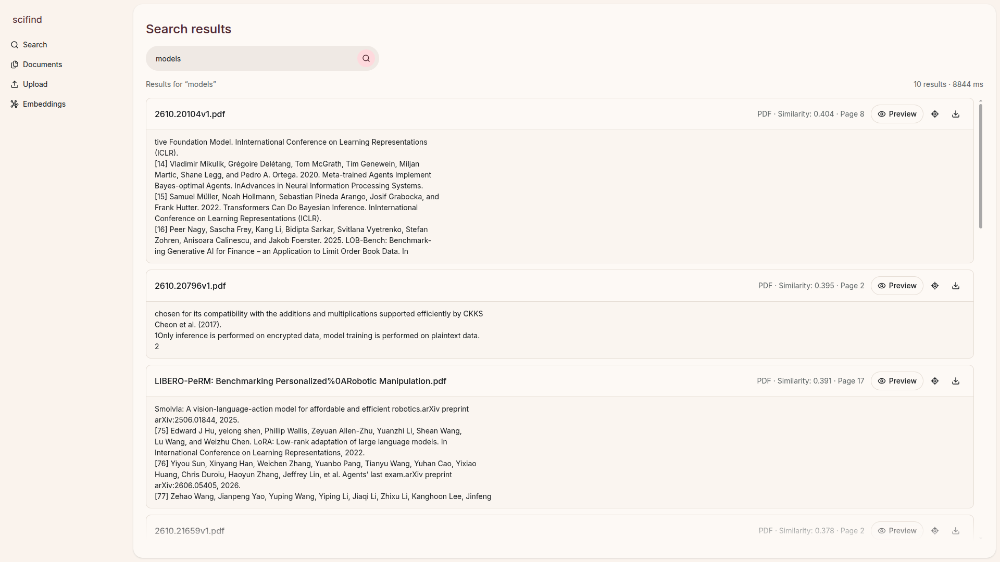
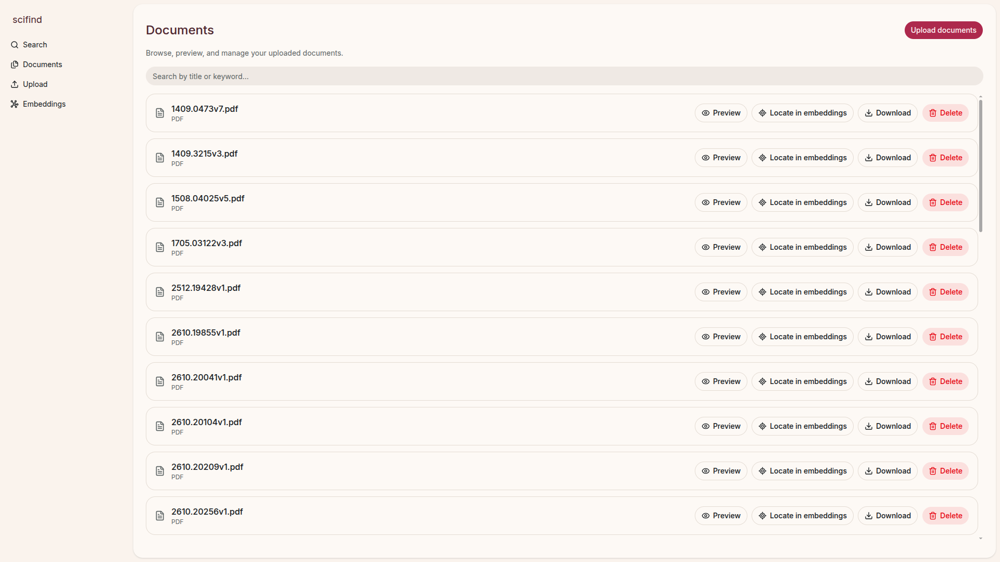
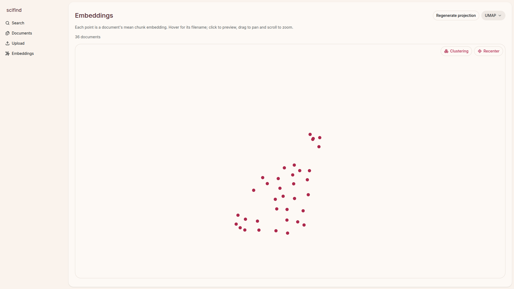
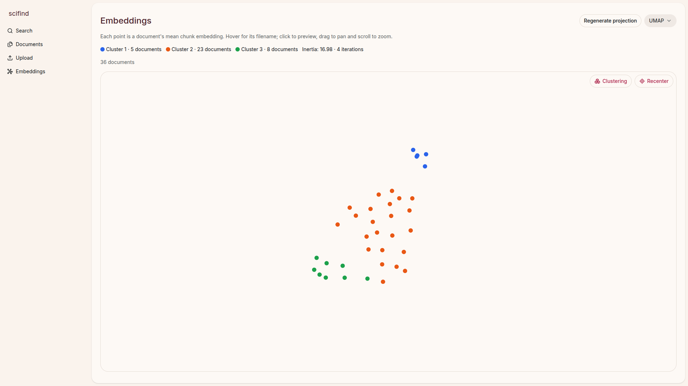

# scifind

scifind is a semantic document finding program based on [sentence-transformers/all-MiniLM-L6-v2](https://huggingface.co/sentence-transformers/all-MiniLM-L6-v2) (Apache 2.0).

## Screenshots

### Search results



### Document management



### Embedding map (UMAP)



### K-Means clustering



## Run with Docker Compose

From the `scifind` directory, run:

```bash
docker compose up -d --build
```

Open http://localhost:3000. Docker builds the API and frontend, downloads the
embedding model, and waits for the API before starting the frontend. The first
build can take a while and needs internet access and several GB of disk space
for the Python/ML dependencies. No `.env` file or local Python/Node setup is needed.
Set `SCIFIND_PORT` to use a different frontend port, for example
`SCIFIND_PORT=8080 docker compose up -d --build`.

The frontend serves the app and proxies `/api/` to `api:8000` on the Compose
network. Browser requests use the same origin as the frontend, including when
accessing it from another machine. The API and embedded ChromaDB are internal;
ChromaDB runs in the API process and does not need a separate database server.

The `chroma_data` named volume stores ChromaDB, initialized from the included
`base-embeddings-1pct.zip` on first creation. The `uploads` named volume keeps
original uploaded files. Existing host `chroma/` and `uploads/` directories are
not imported. Rebuilding or running `docker compose down` preserves both
volumes; `docker compose down -v` deletes them and resets the app's data.

Check status and logs with `docker compose ps` and `docker compose logs -f`.

Note that first search and visualization runs could take a few seconds since loading the model into RAM takes time. By default the image does preload it but loading into RAM still takes ~15secs.

## Run locally

From the `scifind` directory, run:

```bash
uv run scifind
```

uv installs the app and its dependencies into `scifind/.venv` automatically,
using `scifind/uv.lock`. No virtual environment activation is required.
The API runs at http://127.0.0.1:8000; press Ctrl+C to stop it.

scifind is an independent uv project within the vault repository, with its own
dependencies, lockfile, and virtual environment.

Run the tests from the same directory:

```bash
uv run test
```

## Frontend

With the API running, start the frontend in another terminal:

```bash
cd frontend
pnpm install
pnpm dev
```

Open http://localhost:3000. Search submits to `GET /api/search?q=...`.
To change the API base URL, copy `frontend/.env.example` to `frontend/.env`
and set `VITE_API_URL`. The URL is validated by t3-env; restart Vite after
changing it (or rebuild for deployment).

For a frontend hosted elsewhere, set `SCIFIND_FRONTEND_ORIGINS` on the API
to a comma-separated list of allowed origins. It defaults to
`http://localhost:3000,http://127.0.0.1:3000`.

## Partial Capstone submission requirements

### Data acquisition

Data for this project will be acquired through two paths:

1. The [arXiv Scientific Research Papers Dataset](https://www.kaggle.com/datasets/sumitm004/arxiv-scientific-research-papers-dataset) (Apache 2.0)
2. User submissions through PDFs or TXTs


### Architecture

The architecture for scifind is based around Python and ChromaDB with a frontend, API and database. [Chroma](https://www.trychroma.com) will store embedding vectors. The Sentence Transformer models has a limited context width, so documents will be chunked and vectorized in parts.


The frontend will be a React app connected to the backend through HTTP.

### Processing pipeline

The processing pipeline will be simple and aware of MiniLM's context window. Documents will be processed in chunks and uploaded separately to the vector database with metadata linking to the original document.

PDFs will be converted to text using the [PyPDF library](https://pypi.org/project/pypdf/) and TXT files (plain text) will be chunked and processed as-is.

Chunking will include some overlap to preserve some of the relevant context of the sentence, although this is still something to test in the [playground](./playground.ipynb) to find the optimal value.

### Visualizing embeddings

The frontend will include a way to visualize documents close in embedding space to the current one or the search query itself. The frontend will allow choosing different projections like UMAP or PCA.

### Filtering

An optional filtering option will be implemented to filter documents too distinct from the current dataset (like if there are no documents in a given cosine distance of the document the user is currently trying to be upload)


### Notebooks

Check out the included notebooks showcasing the dataset and running embeddings in `notebooks/`.
