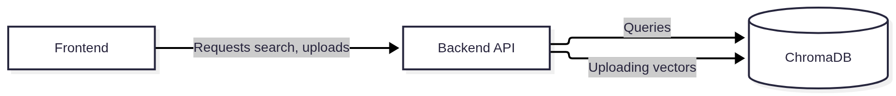

# scifind

scifind is a semantic document finding program based on [sentence-transformers/all-MiniLM-L6-v2](https://huggingface.co/sentence-transformers/all-MiniLM-L6-v2) (Apache 2.0).

## Run locally

From the `scifind` directory, run:

```bash
uv run scifind
```

uv installs the app and its dependencies into `scifind/.venv` automatically,
using `scifind/uv.lock`. No virtual environment activation is required.
The API runs at http://127.0.0.1:8000; press Ctrl+C to stop it.

scifind is an independent uv project within the vault repository, with its own
dependencies, lockfile, and virtual environment.

Run the tests from the same directory:

```bash
uv run test
```

## Partial Capstone submission requirements

### Data acquisition

Data for this project will be acquired through two paths:

1. The [arXiv Scientific Research Papers Dataset](https://www.kaggle.com/datasets/sumitm004/arxiv-scientific-research-papers-dataset) (Apache 2.0)
2. User submissions through PDFs or TXTs


### Architecture

The architecture for scifind is based around Python and ChromaDB with a frontend, API and database. [Chroma](https://www.trychroma.com) will store embedding vectors. The Sentence Transformer models has a limited context width, so documents will be chunked and vectorized in parts.



The frontend will be a React app connected to the backend through HTTP.

### Processing pipeline

The processing pipeline will be simple and aware of MiniLM's context window. Documents will be processed in chunks and uploaded separately to the vector database with metadata linking to the original document.

PDFs will be converted to text using the [PyPDF library](https://pypi.org/project/pypdf/) and TXT files (plain text) will be chunked and processed as-is.

Chunking will include some overlap to preserve some of the relevant context of the sentence, although this is still something to test in the [playground](./playground.ipynb) to find the optimal value.

### Visualizing embeddings

The frontend will include a way to visualize documents close in embedding space to the current one or the search query itself. The frontend will allow choosing different projections like UMAP or PCA.

### Filtering

An optional filtering option will be implemented to filter documents too distinct from the current dataset (like if there are no documents in a given cosine distance of the document the user is currently trying to be upload)


### Notebooks

Check out the included notebooks showcasing the dataset and running embeddings in `notebooks/`.
